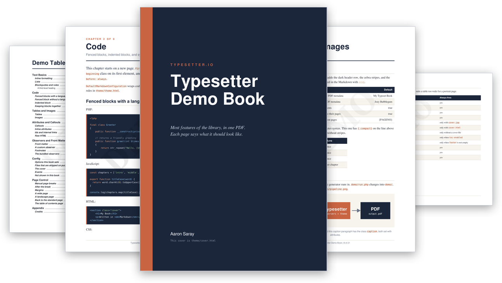

# Typesetter Demo Book

A small book that exercises the library's features: every config option, every bundled observer, a custom observer, custom fonts, and an HTML cover.

<p align="center">
    
</p>

## Generate it

The PDF is built locally and is not stored in the repository. This folder is not part of the Composer package either, so clone the repository to get it. Requires PHP 8.4 or newer and Composer.

```bash
git clone https://github.com/TypesetterIO/typesetter.git
cd typesetter
composer install
php demo/run.php
```

This writes `demo/output.pdf`. Edit anything in this folder and run it again to see the effect.

See the [documentation](https://typesetter.io) for every option.
